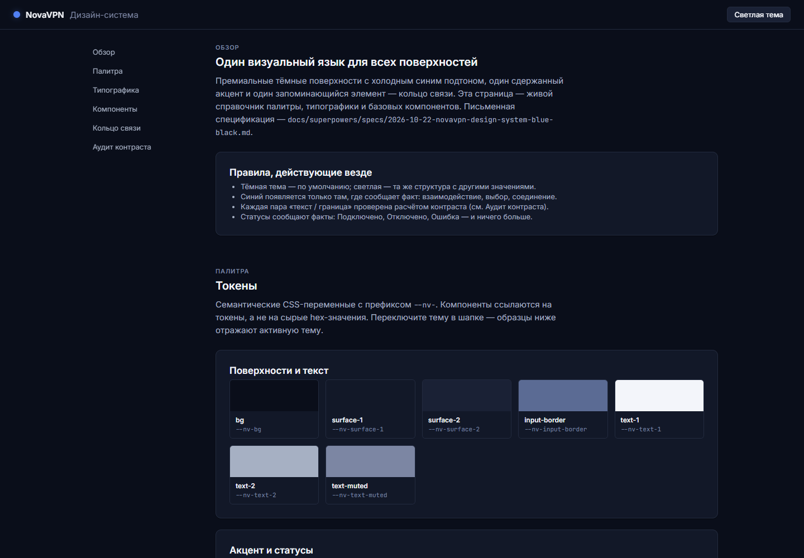
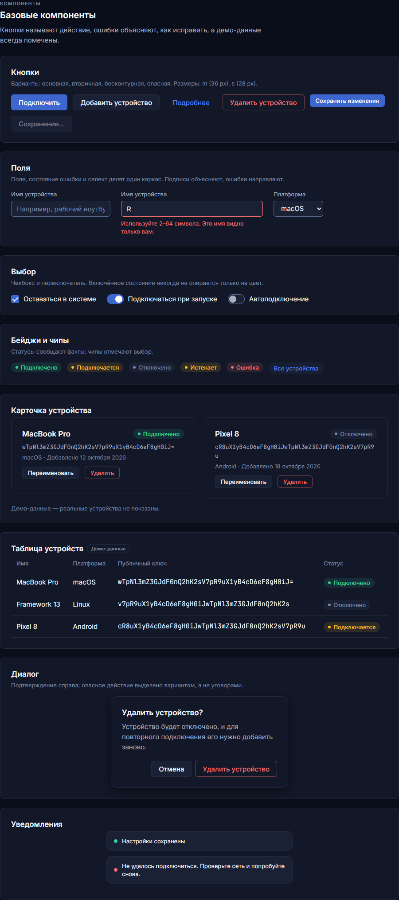
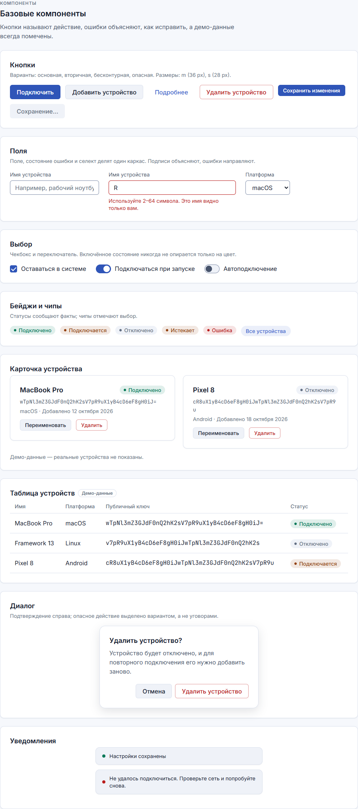
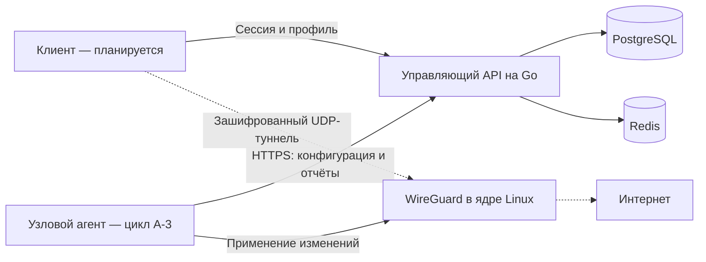

# NovaVPN

**Управление доступом к WireGuard: аккаунты, устройства, профили и VPN-узлы.**

NovaVPN — разрабатываемый русскоязычный VPN-продукт с собственным серверным API и управляемыми узлами WireGuard. Серверная часть решает, кому разрешено подключаться, выдаёт сетевые параметры, учитывает устройства и отзывает доступ. Шифрование туннеля выполняет WireGuard, а не самописный протокол.

> **Статус: активная разработка, не готовый сервис.** В `main` завершены циклы A-1 и A-2 — ядро доступа и управление профилями. Узловой агент и сквозной стенд разрабатываются в ветке `cycle/a3-node-runtime`. Установщика клиента пока нет; первым планируется Windows. Скриншоты ниже показывают дизайн-систему, а не работающее VPN-приложение.

[Возможности](#что-уже-реализовано) / [Скриншоты](#дизайн-и-скриншоты) / [Запуск](#локальный-запуск-api) / [Проверки](#проверки) / [Документация](#документация)

## Что уже реализовано

| Область | Возможности серверной части |
| --- | --- |
| Аккаунты и сессии | Регистрация, вход, хеширование паролей через Argon2id, короткоживущие JWT, ротация токенов продления и обнаружение их повторного использования |
| Устройства | Регистрация публичного ключа WireGuard, список устройств, жёсткий лимит по тарифу, отзыв устройства и связанных профилей |
| Профили | Выделение туннельных адресов, выдача и отзыв профиля, формирование конфигурации без клиентского приватного ключа, ротация ключа с окном перекрытия |
| Каталог узлов | Доступные серверы, состояние по свежести служебных сообщений; неизмеренные показатели возвращаются как `null`, а не как вымышленные числа |
| Контракт узла | Одноразовая регистрация, узловые токены, желаемый набор пиеров с `ETag`/304, отчёты о состоянии и счётчиках |
| Администрирование | Отдельный вход администратора, управление серверами, стартовые токены узлов, блокировка пользователей и аудит действий |
| Обслуживание | Фоновая обработка просроченных профилей, неактивных устройств, устаревшего состояния узлов и сроков хранения данных |
| Надёжность API | Единый формат ошибок, идентификатор запроса, ограничения частоты, идемпотентность критических операций и описание OpenAPI |

Реализованное серверное управление не означает, что сквозное VPN-соединение уже готово. Фактический охват проверок и оставшиеся ограничения перечислены в [статусе проверок](docs/testing-status.md).

## Дизайн и скриншоты

Холодная сине-чёрная палитра, тёмная и светлая темы, русские подписи и кольцо состояния соединения. Исходник — [интерактивная HTML-витрина](design/showcase.html), правила — [спецификация дизайн-системы](docs/superpowers/specs/2026-10-22-novavpn-design-system-blue-black.md).

**Обзор тёмной темы**



<details>
<summary><strong>Компоненты: тёмная и светлая темы</strong></summary>

| Тёмная тема | Светлая тема |
| --- | --- |
|  |  |

</details>

Снимки сделаны из браузера, а не сгенерированы. Данные устройств в витрине демонстрационные; кнопка соединения переключает только визуальное состояние, не создавая туннель. При съёмке проверены обе темы на ширинах 360, 900 и 1440 пикселей, переключение темы и кольца, отсутствие горизонтального переполнения страницы и ошибок консоли.

## Как устроен проект

Управляющий API и передача пользовательского трафика — отдельные части системы:



API хранит пользователей, права, устройства и профили. Агент должен забирать разрешённый набор пиеров и применять только изменения через интерфейс ядра. Пользовательский трафик проходит через VPN-узел, а не через управляющий API.

Принципиальные ограничения:

- Приватный ключ клиента не передаётся серверу и не включается в выдаваемую сервером конфигурацию. Перед подключением клиент должен локально добавить свой ключ.
- Приватный ключ узла создаётся на самом узле; API получает только публичный ключ.
- Для рабочего узлового соединения обязателен HTTPS с проверкой сертификата. Исключения допустимы только в среде разработки.
- Отзыв доступа меняет желаемый набор пиеров. Срок фактического отключения на живом туннеле требует отдельного сквозного замера и пока не заявляется как проверенный.
- Неизмеренные задержка и нагрузка не подменяются нулём. Числа скорости и пропускной способности без испытаний не публикуются.

## Технологии

| Компонент | Основа |
| --- | --- |
| Управляющий API | Go 1.25, стандартный `net/http` |
| Постоянные данные | PostgreSQL 17, `pgx`, SQL-запросы с генерацией через `sqlc` |
| Краткоживущее состояние | Redis 7: отзыв токенов, ограничения частоты и идемпотентность |
| Аутентификация | Argon2id, JWT, криптографически случайные токены |
| Сеть узла в A-3 | WireGuard, `wgctrl`, Linux netlink |
| Контракт | OpenAPI, проверка схем и ответов API |
| Локальная среда | Docker, Docker Compose, GNU Make |
| Витрина дизайна | HTML, CSS, JavaScript без сборки; шрифты Inter и JetBrains Mono |

Версии библиотек закреплены в [go.mod](go.mod) и [go.sum](go.sum).

## Локальный запуск API

Это запуск **среды разработки управляющего API**, а не установка VPN-сервера. Нужны Git, Docker с Linux-контейнерами, Docker Compose v2, GNU Make и оболочка Bash. Go на хосте не требуется: команды Makefile используют контейнерный инструментарий. В Windows можно использовать WSL2 с интеграцией Docker Desktop и установленным `make`.

### 1. Подготовить исходники и настройки

```bash
git clone https://github.com/zanzibara82/nova-vpn.git
cd nova-vpn
cp -n infrastructure/docker/.env.dev.example infrastructure/docker/.env.dev
```

В созданном файле заполните `NOVAVPN_JWT_SECRET`: строка base64, кодирующая не менее 32 криптографически случайных байт. Получите её локально из доверенного генератора и сохраните непосредственно в файл — не в аргументы команд, историю терминала или репозиторий. Не используйте пример, пароль или строку из документации в качестве секрета. Существующий секрет не заменяйте при повторном запуске.

`.env.dev` исключён из Git. Остальные значения образца предназначены только для локального стенда. `NOVAVPN_ENV=dev` не превращает окружение в безопасное для публичного доступа.

### 2. Запустить зависимости и применить миграции

Для примера используются порты, отличные от стандартных, чтобы не затронуть уже установленные PostgreSQL и Redis:

```bash
export POSTGRES_HOST_PORT=55433
export REDIS_HOST_PORT=16380
export MSYS_NO_PATHCONV=1
make up-dev
make migrate-up
make run-dev
```

Проверьте, что выбранные порты свободны. При конфликте измените переменные до запуска и используйте одинаковые значения для миграций, API и тестов. Makefile передаёт контейнерам адреса зависимостей с учётом этих портов. Переменная `MSYS_NO_PATHCONV` нужна для путей Docker в Git Bash; в Linux она не влияет на запуск.

API слушает порт `8080`. В другом терминале:

```bash
curl --fail http://localhost:8080/debug/health
```

Этот маршрут подтверждает только работу HTTP-процесса, **не** доступность базы, Redis или VPN-туннеля. `Ctrl+C` завершает API.

> Локальный Compose публикует порты PostgreSQL и Redis, а `run-dev` — порт API. В стенде используются общие тестовые реквизиты и HTTP. Не запускайте его на публичном хосте и не открывайте эти порты в Интернет. Готовая защищённая схема развёртывания ещё разрабатывается.

### 3. Остановить стенд без удаления контейнеров

```bash
docker compose -f infrastructure/docker/docker-compose.dev.yml stop
```

Внимание: `make down-dev` вызывает `down -v` и удаляет тома, а `make migrate-down` откатывает **все** миграции. Это разрушительные операции для данных стенда, не обычные команды остановки. Среда разработки не является системой резервного копирования.

## Проверки

Запускайте из корня репозитория. Для интеграционных проверок нужны только выделенные тестовые PostgreSQL и Redis; **не направляйте тесты на рабочие данные**. При нестандартных портах сохраните переменные из раздела запуска.

```bash
make unit
make vet
make up-dev
make integration
make api-lint
```

| Команда | Что проверяет |
| --- | --- |
| `make unit` | Модульные тесты всех пакетов |
| `make vet` | Статические проверки Go |
| `make integration` | Сценарии с PostgreSQL и Redis, конкурентные операции, матрицу доступа, соответствие живых ответов OpenAPI |
| `make api-lint` | Описание OpenAPI |

Для работы со схемой доступны `make sqlc-generate` и `make mod`; они обновляют сгенерированный код и зависимости соответственно. Для генератора и проверки OpenAPI в Git Bash также нужен `MSYS_NO_PATHCONV=1`.

Полная матрица доказательств находится в [docs/testing-status.md](docs/testing-status.md). Раздел `not-run` — явный список того, что ещё не проверено; планы, исходники и красивые скриншоты не заменяют испытаний.

## Структура репозитория

| Путь | Назначение |
| --- | --- |
| [`services/api/`](services/api/) | Сборка HTTP-маршрутов и команда `novavpn-api` |
| [`internal/`](internal/) | Аутентификация, права, устройства, профили, серверы, телеметрия и администрирование |
| [`internal/db/`](internal/db/) | SQL-запросы, сгенерированный доступ к данным и миграционный раннер |
| [`migrations/`](migrations/) | Версионированная схема PostgreSQL |
| [`api-spec/`](api-spec/) | OpenAPI и проверки описания контракта |
| [`tests/integration/`](tests/integration/) | Интеграционные сценарии |
| [`infrastructure/docker/`](infrastructure/docker/) | Локальный Compose и образец настроек |
| [`design/`](design/) | Интерактивная витрина дизайн-системы |
| [`docs/`](docs/) | Спецификации, решения, планы, эксперименты и статус проверок |

## Этапы развития

| Этап | Содержание | Состояние |
| --- | --- | --- |
| A-1 | Схема, сессии, права и устройства | Завершён, в `main` |
| A-2 | Профили, каталог, контракт узла, телеметрия и администрирование | Завершён, в `main` |
| A-3 | Агент узла, настоящий туннель, DNS, TLS, развёртывание и сквозные испытания | В разработке, отдельная ветка |
| Дальнейшие циклы | Платежи, эксплуатационная готовность, пользовательский кабинет и приложения | Запланированы, не представлены как готовые |

Пока **не реализованы или не подтверждены сквозными испытаниями**: готовый Windows-клиент, системная блокировка трафика при обрыве VPN, раздельная маршрутизация приложений, отсутствие утечек DNS/IPv6, публичное развёртывание узла, платежи и нагрузочные показатели. Не используйте текущую сборку как доказанную защиту трафика.

## Документация

- [Спецификация ядра доступа и модель угроз](docs/superpowers/specs/2026-10-20-novavpn-cycle-a-access-core-design.md)
- [Контракт API — OpenAPI](api-spec/openapi.yaml)
- [Дизайн-система](docs/superpowers/specs/2026-10-22-novavpn-design-system-blue-black.md)
- [Почему WireGuard получает дельту, а не полную замену пиеров](docs/adr/0004-wireguard-peer-apply.md)
- [Проверки WireGuard в контейнере](docs/spikes/2026-10-20-s1-s3-wireguard-netlink.md)
- [План A-1](docs/superpowers/plans/2026-10-20-novavpn-cycle-a1-data-sessions-devices.md)
- [План A-2](docs/superpowers/plans/2026-10-23-novavpn-cycle-a2-profiles-servers-nodeapi.md)
- [План A-3](docs/superpowers/plans/2026-10-27-novavpn-cycle-a3-node-runtime.md)
- [Что проверено и что ещё нет](docs/testing-status.md)

## Участие и лицензия

При изменении поведения добавляйте тест, обновляйте контракт и статус проверок. Не прикладывайте к отчётам реальные токены, приватные ключи, пароли или конфигурации с секретами.

Лицензия пока не выбрана: файла `LICENSE` в репозитории нет. Публичная доступность исходников сама по себе не означает разрешения на произвольное использование и распространение.
